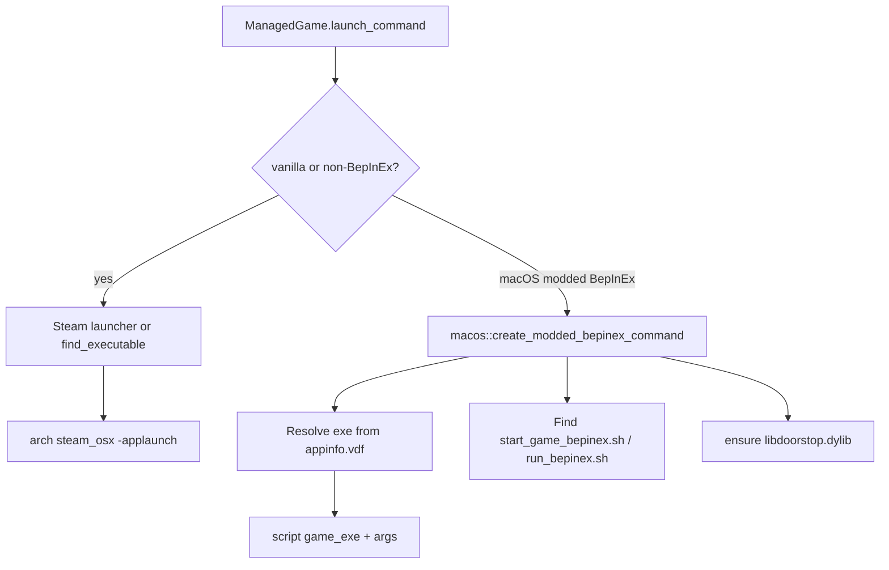

# macOS support

Developer notes on how Gale runs on macOS: the constraints that shaped the design, the launch strategies, and the smaller platform plumbing around deep links, menus, and stubs.

## Overview

Most of Gale already works cross-platform through Tauri, `dirs_next`, and `steamlocate`. Explicit macOS code exists where behaviour diverges — mainly **launching modded BepInEx games** and a few OS integration points (deep links, app menu, keychain).

The central constraint:

> `steam_osx` cannot inject Doorstop the way Windows proxy DLLs or Linux Proton `WINEDLLOVERRIDES` do.

A plain Steam `-applaunch` therefore cannot load BepInEx on macOS. Modded BepInEx launches bypass Steam and run BepInEx’s start script against a resolved game executable instead.

## Launch architecture



Entry point: `ManagedGame::launch_command` in `src-tauri/src/profile/launch/mod.rs`.

### Vanilla / non-BepInEx path

When the launch is vanilla, or the game uses a non-BepInEx mod loader, Gale uses the shared Steam launcher path (`platform::create_launch_command` → `-applaunch <appid>`), falling back to `find_executable` when needed.

macOS-specific Steam client resolution lives in `create_base_steam_command` (`src-tauri/src/profile/launch/platform.rs`):

- `steamlocate` returns the Steam **data** directory (`~/Library/Application Support/Steam`), not `/Applications/Steam.app`.
- The real client binary is nested at `Steam.AppBundle/Steam/Contents/MacOS/steam_osx`.
- The command is wrapped as `arch <steam_osx>` with `ARCHPREFERENCE=arm64,x86_64` and `STEAM_RUNTIME=1` so Apple Silicon is preferred.

### Modded BepInEx path

For `!vanilla` + `ModLoaderKind::BepInEx`, macOS takes an early return that:

1. Builds a command via `macos::create_modded_bepinex_command`.
2. Forces `LaunchMode::Direct { instances: 1, … }`, ignoring the user’s launcher / multi-instance preferences.

Rationale: Doorstop must be applied to the **game process**. The BepInEx shell scripts do that with `arch -e DYLD_*`; Steam cannot.

Implementation: `src-tauri/src/profile/launch/macos.rs`.

#### Script + executable injection

Gale does **not** generate the start scripts. It expects them from the BepInEx pack (or already present in the game directory):

- Candidates: `start_game_bepinex.sh`, then `run_bepinex.sh`
- Search order: profile directory, then game directory
- Missing exec bits are fixed with `chmod` (`0o755`)

The command is effectively:

```text
<script> <resolved_game_exe> --doorstop-… <mod-loader args> <custom args>
```

with `current_dir` set to the game directory. `SteamAppId` / `SteamGameId` are set when a Steam app id is available so the game does not try to relaunch itself through Steam.

Doorstop CLI args come from the shared `mod_loader::ArgsContext` with `is_proton = false` (macOS is gated under `#[cfg(not(target_os = "linux"))]` for proton detection).

#### Why not `find_executable`?

The generic `find_executable` walk only accepts `.exe` / `.sh` extensions. It cannot discover macOS `.app` / `.appbundle` layouts, so modded launch resolves the binary from Steam’s `appinfo.vdf` instead.

#### Executable resolution from appinfo

`resolve_game_executable` requires a Steam app id, then:

1. Reads `<steam>/appcache/appinfo.vdf` via `platform::get_steam_launch_options`.
2. Skips launch options that have a `config.BetaKey` (same best-effort beta-branch workaround as elsewhere).
3. Keeps entries whose `config.oslist` is empty or contains `macos`.
4. Prefers `type == "default"`.
5. Materialises the relative `executable` path under the install dir.

Steam’s relative paths are inconsistent on macOS:

| Example | appinfo `executable` | Meaning |
|---|---|---|
| Valheim | `valheim.app` | Bundle at install root |
| DEPO | `Contents/MacOS/DEPO` | Path **inside** a bundle; Steam omitted the `Foo.app/` prefix |

`materialize_steam_executable` handles both: try `game_dir.join(relative)` first; if `relative` starts with `Contents/`, scan `*.app` / `*.appbundle` (skipping Unity `BurstDebugInformation` / `DoNotShip` debug bundles) and prefer a bundle whose stem matches the exe name.

#### Doorstop dylib prep

Before launch, `copy_required_files` copies profile assets such as `doorstop_libs` into the game directory.

`ensure_libdoorstop` then ensures `libdoorstop.dylib` exists at the game root by copying `doorstop_libs/libdoorstop_x64.dylib` when needed. Failure is logged as a warning so launch can still proceed (the script may fail later). Only the x64 dylib is handled; arm64 relies on the script’s `arch` usage.

## Platform plumbing

### Deep links

Schemes `ror2mm` and `gale` are declared in `tauri.conf.json` (`plugins.deep-link.desktop.schemes`) and end up in the bundle Info.plist. On macOS, runtime `deep_link().register()` is not used — schemes must come from the bundle.

Instead, `deep_link::setup_macos` (`src-tauri/src/deep_link.rs`):

- Subscribes to `on_open_url` for URLs while the app is already running.
- Calls `get_current()` for a URL that launched the app cold.

Windows/Linux still register both schemes at startup in `lib.rs`.

### Native menu

`src/lib/components/menubar/Menubar.svelte` detects macOS via `@tauri-apps/plugin-os`.

- **Native menu on:** start from `Menu.default()`, keep the first item (application menu: About / Hide / Quit / Cmd+Q), strip the remaining default submenus, append Gale’s menus.
- **Native menu off:** do **not** set an empty menu (that would remove Quit). Call `keepMacOsAppMenuOnly()` so Cmd+Q still works.

### Keyring

`src-tauri/Cargo.toml` enables the `apple-native` feature on `keyring` so credentials can use the macOS Keychain alongside the existing Windows/Linux backends.

### Custom launch args

`custom_args.rs` uses `#[cfg(unix)]` (was Linux-only) so macOS shares Linux’s `shell_words` join/split behaviour for quoting.

### Unsupported / stubs

| Area | Behaviour |
|---|---|
| Desktop shortcuts | `create_desktop_shortcut` bails with “not supported on macOS” (`profile/actions.rs`) |
| System accent colour | `system_accent()` returns `None` (`util/color.rs`) |
| Webview zoom | No-op on non-Linux; unused params silenced in `util/window.rs` |

Path / data / log directories use existing `dirs_next` + `com.kesomannen.gale` helpers — no macOS-specific changes in this work.

## Key files

| Path | Role |
|---|---|
| `src-tauri/src/profile/launch/macos.rs` | Modded BepInEx launch: exe resolve, script find, doorstop prep |
| `src-tauri/src/profile/launch/mod.rs` | Early macOS BepInEx override; proton `cfg` widened to non-Linux |
| `src-tauri/src/profile/launch/platform.rs` | `steam_osx` via `arch`; shared appinfo helpers |
| `src-tauri/src/profile/launch/custom_args.rs` | Unix shell-words for custom args |
| `src-tauri/src/deep_link.rs` | macOS `on_open_url` / `get_current` setup |
| `src-tauri/src/lib.rs` | Platform-split deep-link registration vs macOS setup |
| `src-tauri/src/profile/actions.rs` | Desktop shortcuts unsupported on macOS |
| `src-tauri/src/util/color.rs` | Accent colour stub |
| `src-tauri/src/util/window.rs` | Unused zoom params on non-Linux |
| `src-tauri/Cargo.toml` | `keyring` `apple-native` |
| `src/lib/components/menubar/Menubar.svelte` | Preserve macOS app menu / Quit |

## Known limitations

- Modded BepInEx requires a Steam app id and a matching macOS launch entry in `appinfo.vdf`. Beta-branch filtering is best-effort (`BetaKey` skip).
- Start scripts must already exist in the BepInEx pack or game dir; Gale only finds and chmod’s them.
- Only `libdoorstop_x64.dylib` is copied; arm64 depends on the script’s `arch` handling.
- Non-BepInEx mod loaders fall through to the generic Steam / direct path and are likely incomplete on macOS.
- The modded path always runs a single Direct instance (no multi-instance).
- Desktop shortcuts and system accent colour are intentionally unsupported.
- appinfo executable paths vary by game; the resolver has special-cases for bundle-relative `Contents/…` paths.
